# Code&Colors

<div align="center">

```
   ██████╗ ██████╗ ██████╗ ███████╗   ██████╗     ██████╗ ██████╗ ██╗      ██████╗ ██████╗ ███████╗
  ██╔════╝██╔═══██╗██╔══██╗██╔════╝   ╚════██╗   ██╔════╝██╔═══██╗██║     ██╔═══██╗██╔══██╗██╔════╝
  ██║     ██║   ██║██║  ██║█████╗      █████╔╝   ██║     ██║   ██║██║     ██║   ██║██████╔╝███████╗
  ██║     ██║   ██║██║  ██║██╔══╝      ╚═══██╗   ██║     ██║   ██║██║     ██║   ██║██╔══██╗╚════██║
  ╚██████╗╚██████╔╝██████╔╝███████╗   ██████╔╝   ╚██████╗╚██████╔╝███████╗╚██████╔╝██║  ██║███████║
   ╚═════╝ ╚═════╝ ╚═════╝ ╚══════╝   ╚═════╝     ╚═════╝ ╚═════╝ ╚══════╝ ╚═════╝ ╚═╝  ╚═╝╚══════╝
```

### *Where Art Meets Algorithm*

[](https://github.com/mahik504/Code-Colors)
[](LICENSE)
[](#48-painting-styles)
[](#webgl-2-relief-rendering)
[](#3d-studio-viewport)
[](#testing--verification)

*An independent, production-grade generative art workstation that transforms imagery, video, camera input, and 3D geometry into living, stroke-by-stroke algorithmic paintings with live code streaming.*

</div>

---

## ✦ Overview

**Code&Colors** is a digital art studio and creative-coding instrument. Rather than applying flat convolutional filters or static mockups, Code&Colors executes an algorithmic painting engine where every single brush stroke, thread, knife mark, or metallic bead is calculated, rasterized, and written out as live JavaScript code in real time.

Built on an independent design language—**Porcelain × Cherry × Rose × Graphite**—the application marries the tactile sensation of a physical art atelier with the computational precision of modern WebGL 2 and Web Audio technology.

### Key Highlights
- **Engine Continuity**: All 48 generative painting styles preserved across 5 artistic suites.
- **Default Masterpiece**: Vincent van Gogh's *The Starry Night* (1889) serves as the primary default reference painting, synchronized across source input, canvas painter, reference preview, and stylized filters.
- **Atmospheric Visual Identity**: Lightweight porcelain-to-rose gradient mesh with mouse-reactive parallax and custom desktop cherry glow cursor.
- **Real-Time WebGL 2 Relief**: Normal map and height map generation, impasto rendering, thick acrylic surfaces, and dynamic 3D lighting pad.
- **Audio-Reactive Engine**: 512-band FFT frequency analyzer, transient detector, and 10 bundled demonstration audio tracks modulating stroke width, height, and light flares.
- **MediaPipe Landmark Detection**: Bundled offline face and pose landmark extraction with zero cloud dependencies.
- **3D Studio Viewport**: Three.js r160 studio environment supporting GLTF/GLB, OBJ, STL, and PLY formats with interactive OrbitControls and live canvas sampling.
- **Multi-Format Master Export**: Standalone self-contained HTML programs, 8K PNG master exports with embedded metadata, SVG vector output, and 60 FPS WebCodecs MP4 video recording.

---

## 🎨 Design System: Porcelain & Cherry

Code&Colors transitions away from dark terminal dashboards to an editorial, light-first creative studio identity:

| Token | Hex Value | Role |
| :--- | :--- | :--- |
| `--bg-main` | `#FAF7F5` | Main warm porcelain workstation base |
| `--surf-porcelain` | `#FFFFFF` | Primary surface panels and control surfaces |
| `--bg-warm` | `#F2EBE8` | Secondary wells, tracks, and segment backgrounds |
| `--primary-cherry` | `#A8173B` | Identity accent, key highlights, primary buttons |
| `--deep-cherry` | `#70132F` | Heading typography accents, dark mode bases |
| `--soft-rose` | `#E9A0B0` | Keylines, glowing borders, rim lighting |
| `--blush-accent` | `#F5DCE2` | Active state indicators and subtle atmospheric glows |
| `--graphite` | `#202024` | Primary high-contrast typography and UI frames |
| `--text-secondary` | `#77717A` | Subtle technical metadata and secondary labels |
| `--border-subtle` | `#E9DDE0` | Precise boundary lines with 1px tactile definition |
| `--success-mint` | `#218B64` | Verified status, playback indicators, and ledger gates |

---

## 📐 Architecture & Pipeline

```mermaid
flowchart TD
    subgraph Inputs["1. Multi-Modal Input Layer"]
        A1["Image / Video Upload"]
        A2["Default: The Starry Night (Van Gogh)"]
        A3["Live Camera / Screen Capture"]
        A4["Three.js 3D Models (GLB/OBJ/STL/PLY)"]
        A5["Web Audio API & Microphone (10 Bundled Tracks)"]
        A6["MediaPipe Face & Pose Detection (Offline WASM)"]
    end

    subgraph CoreEngine["2. Code&Colors Algorithmic Engine"]
        B1["Stroke Synthesizer & Trajectory Engine"]
        B2["48 Style Algorithms (Paint, Draw, Graphic, Craft, 3D)"]
        B3["Audio Reactivity (FFT, Beat & Transient Detection)"]
        B4["Palette & Chromatic Extractors"]
    end

    subgraph Presentation["3. Dual-Layer Viewport"]
        C1["2D Canvas Master (Physical Brush Dynamics)"]
        C2["WebGL 2 Relief Shader (Height Maps, Normals, Lighting Pad)"]
        C3["Three.js 3D Studio (Iridescent Environment & Sampler)"]
        C4["Live JavaScript Code Streamer (IBM Plex Mono)"]
    end

    subgraph Output["4. Master Exporters"]
        D1["Standalone Executable HTML"]
        D2["PNG Master up to 8K (tEXt Metadata)"]
        D3["SVG Vector Artwork"]
        D4["WebCodecs MP4 60FPS Video"]
        D5["Resolume Syphon/Spout Bridge Integration"]
    end

    Inputs --> CoreEngine
    CoreEngine --> Presentation
    Presentation --> Output
```



---

## 🖌️ 48 Painting Styles

Code&Colors houses 48 mathematical painting algorithms organized into five focused suites:

```
┌──────────────┬──────────────┬──────────────┬──────────────┬──────────────┐
│    PAINT     │     DRAW     │   GRAPHIC    │    CRAFT     │ 3D SURFACES  │
├──────────────┼──────────────┼──────────────┼──────────────┼──────────────┤
│ Oil          │ Pencil       │ Flat         │ Thread       │ Ceramic      │
│ Acrylic      │ Charcoal     │ Geometric    │ Cross-Stitch │ Stone        │
│ Palette Knife│ Pastel       │ Dots         │ Clay         │ Puffy        │
│ Gouache      │ Pen          │ Halftone     │ Beads        │ Metal        │
│ Watercolour  │ Cross-Hatch  │ Scribble     │ Foam         │ Molten       │
│ Wet Watercol │ Marker       │ String       │ Tape         │ Pewter       │
│ Sumi         │              │ Paper        │              │ Copper       │
│ Ink          │              │ Bokeh        │              │ Gold         │
│ Calligraphy  │              │ Neon         │              │ Bronze       │
│ Graffiti     │              │ Hylics       │              │ Glass        │
│ Soft Spray   │              │ Linocut      │              │ Lens         │
│              │              │ Riso         │              │ Crystal      │
└──────────────┴──────────────┴──────────────┴──────────────┴──────────────┘
```

---

## ⚡ Quickstart & Local Execution

Code&Colors runs with zero external runtime dependencies. All libraries (Three.js, MediaPipe, fonts) are bundled locally in `vendor/`.

### 1. Node.js (Recommended)
```bash
# Clone the repository
git clone https://github.com/mahik504/Code-Colors.git
cd Code-Colors

# Start the studio server
npm start
# Open http://localhost:8765 in your browser
```

### 2. Python 3
```bash
python serve.py
# Open http://localhost:8765
```

### 3. Windows Native Launcher
Double-click `start.bat`.

### 4. macOS / Linux Launcher
Double-click or run:
```bash
./start.command
```

---

## 🧪 Testing & Verification

Code&Colors includes an automated 26-assertion integration test suite covering syntax compilation, AST inline script parsing, HTTP endpoints, metadata serialization, backward compatibility, and codebase hygiene.

```bash
npm test
```

### Verification Results
```
▶ [Test Suite] Syntax & AST Compilation
  ✅ PASS: viewer3d.js compiles cleanly without syntax errors
  ✅ PASS: serve.mjs compiles cleanly without syntax errors
  ✅ PASS: index.html has rebranded Code&Colors title
  ✅ PASS: index.html links to mahik504 repository
  ✅ PASS: Valid JSON in <script type="importmap">
  ✅ PASS: Successfully parsed and validated 6 inline script blocks in index.html

▶ [Test Suite] HTTP Server Endpoints & Asset Delivery
  ✅ PASS: GET / returns 200 OK
  ✅ PASS: GET / has text/html content-type
  ✅ PASS: GET / body includes "Code&Colors Studio"
  ✅ PASS: GET /package.json returns 200 OK
  ✅ PASS: GET /package.json has application/json
  ✅ PASS: package.json name is code-colors
  ✅ PASS: GET /viewer3d.js returns 200 OK
  ✅ PASS: GET /viewer3d.js has text/javascript
  ✅ PASS: GET /VERSION returns 200 OK
  ✅ PASS: VERSION file content is 1.0.0
  ✅ PASS: GET nonexistent file returns 404 Not Found
  ✅ PASS: Path traversal attempt rejected with 403 or 404

▶ [Test Suite] Metadata Engine & Format Compatibility
  ✅ PASS: META_UUID_V5 is exactly 16 bytes for MP4 uuid box compatibility
  ✅ PASS: META_UUID_LEGACY is exactly 16 bytes
  ✅ PASS: META_UUID_V5 string prefix is "code-colors"
  ✅ PASS: Metadata regex successfully extracts v5 code-colors
  ✅ PASS: Metadata regex successfully extracts legacy code-painter

▶ [Test Suite] Codebase Hygiene & Zero Residuals
  ✅ PASS: Zero occurrences of legacy author references across all repository files

▶ [Test Suite] Portable Offline ZIP Archive
  ✅ PASS: download/code-colors-local.zip exists on disk
  ✅ PASS: ZIP package verified: root is code-colors-local/ with 0 legacy filenames

══════════════════════════════════════════════
Test Summary: 26/26 Passed (0 Failed)
══════════════════════════════════════════════
```

---

## 📦 Project Layout

```
Code&Colors/
├── index.html               # Main studio application & rendering engine
├── viewer3d.js              # Three.js 3D studio viewport & model loader
├── package.json             # NPM metadata & scripts
├── VERSION                  # 1.0.0 release version
├── LICENSE                  # MIT License
├── README.md                # Comprehensive documentation & guides
├── ARCHITECTURE.md          # Technical engine & shader architecture
├── DESIGN.md                # Porcelain x Cherry design system tokens
├── serve.mjs                # Zero-dependency Node.js HTTP server
├── serve.py                 # Zero-dependency Python 3 HTTP server
├── start.bat                # Windows quick launcher
├── start.command            # macOS / Linux quick launcher
├── vercel.json              # Vercel cloud deployment configuration
├── assets/
│   ├── artwork/             # The Starry Night (Vincent van Gogh) assets
│   ├── branding/            # Logo assets and icon representations
│   └── previews/            # 6 stylized filter thumbnails (180x180)
├── audio/demo/              # 10 bundled audio-reactive demo tracks
├── docs/
│   ├── GUIDE.md             # In-depth studio operating manual
│   └── EXECUTION-REPORT.md  # Full audit, migration & verification log
├── download/
│   └── code-colors-local.zip# Complete standalone offline distribution
├── test/
│   └── suite.mjs            # 26-assertion integration test suite
└── vendor/                  # Bundled Three.js, MediaPipe WASM, and fonts
```

---

## 📄 License & Attribution

- Released under the [MIT License](LICENSE).
- Art Reference: *The Starry Night* (1889) by **Vincent van Gogh**, Museum of Modern Art, New York (Public Domain).
- Audio Tracks: Bundled royalty-free demonstration recordings for reactive audio testing.
- Bundled Libraries: Three.js (MIT), MediaPipe (Apache 2.0).
